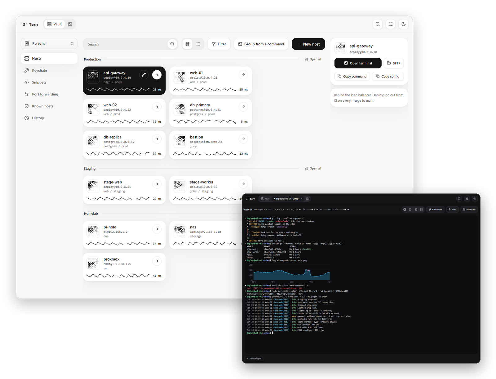
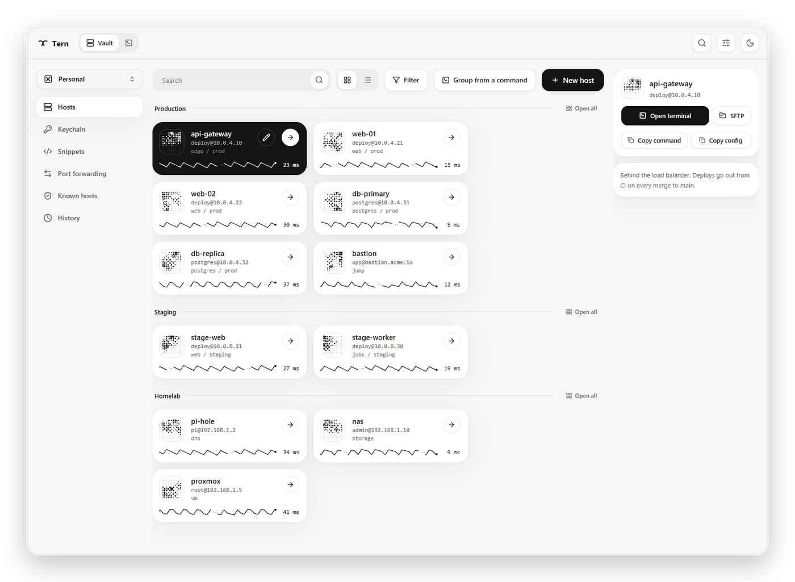
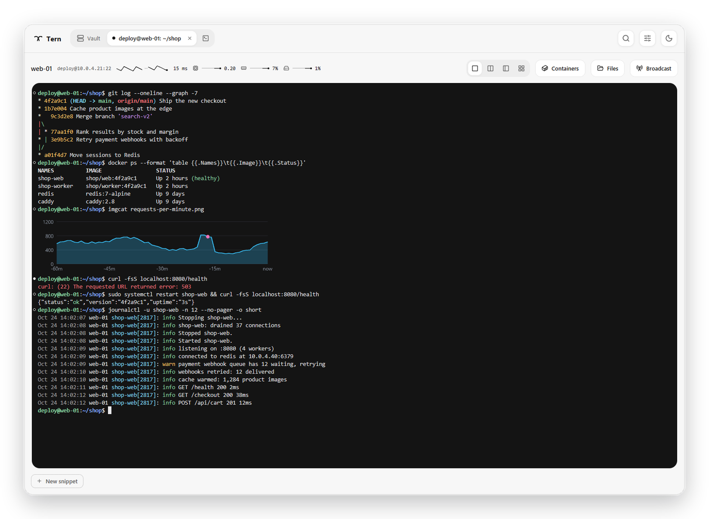
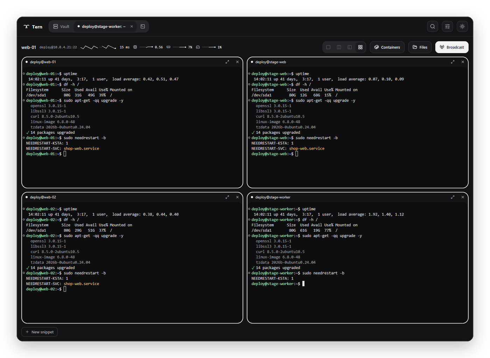
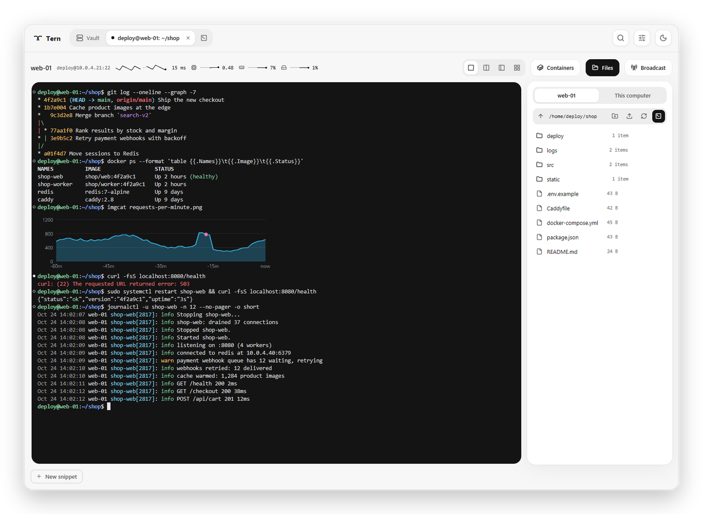
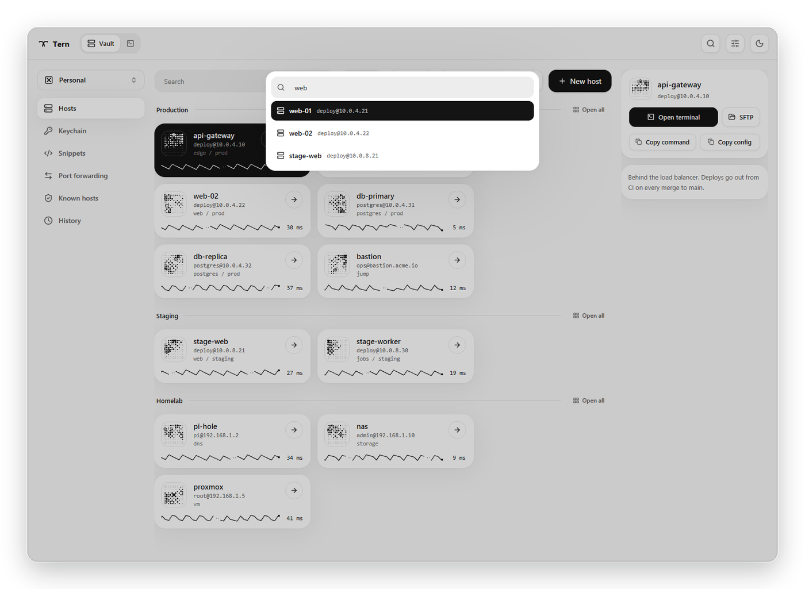
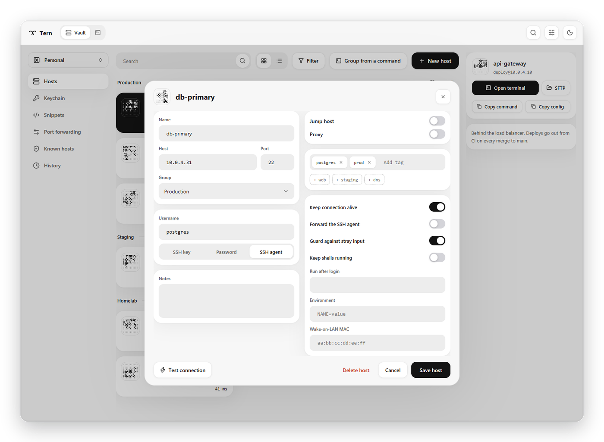
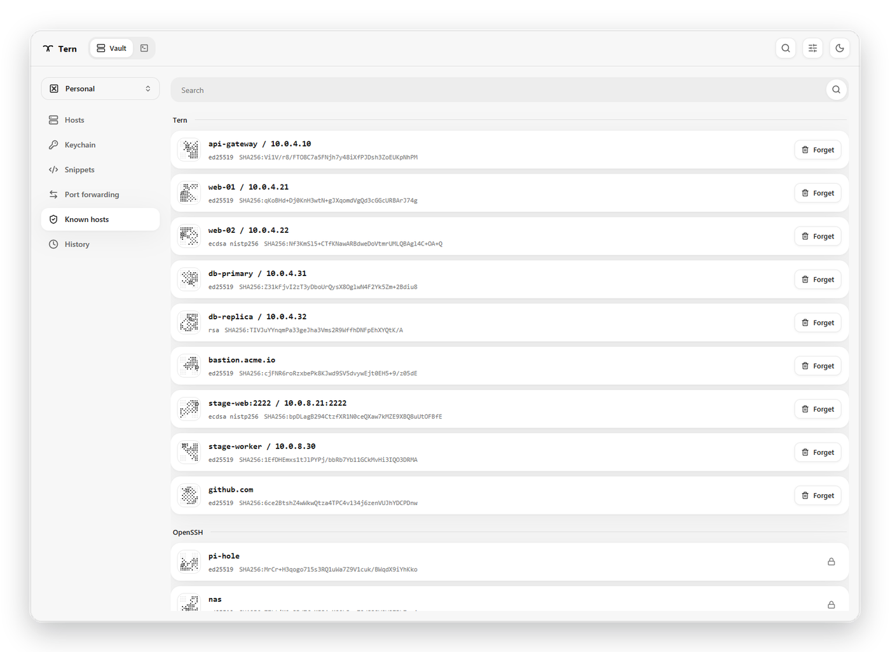
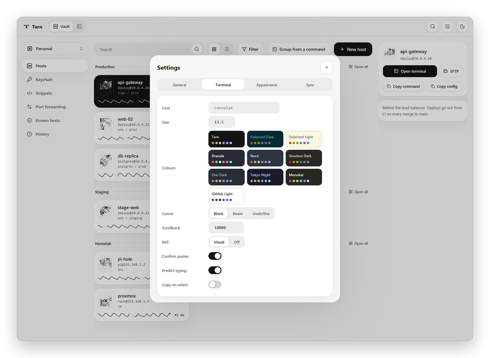
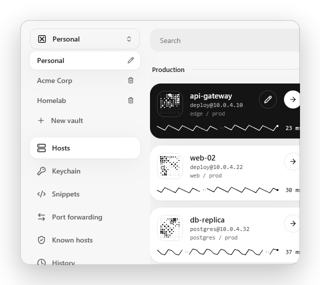

<p align="center">
  <picture>
    <source media="(prefers-color-scheme: dark)" srcset="docs/images/logo-dark.svg">
    
  </picture>
</p>

<h3 align="center">The SSH client that gets out of your way.</h3>

<p align="center">
  Every server you look after, in one calm, fast window.<br>
  Free and open source. No account, no Tern cloud:<br>
  your hosts, your keys, your storage.
</p>

<p align="center">
  <a href="#get-tern"><b>Get Tern</b></a> &nbsp;·&nbsp;
  <a href="#a-quick-tour">Tour</a> &nbsp;·&nbsp;
  <a href="#and-all-the-little-things">Features</a> &nbsp;·&nbsp;
  <a href="#your-data-stays-yours">Your data</a> &nbsp;·&nbsp;
  <a href="ROADMAP.md">Roadmap</a>
</p>

<p align="center">
  <picture>
    <source media="(prefers-color-scheme: dark)" srcset="docs/images/hero-dark.png">
    
  </picture>
</p>

<table>
<tr>
<td width="33%" valign="top">

**Native and quick**

Written in Rust and drawn on the GPU. Opens in about a quarter of a second and stays smooth through floods of output.

</td>
<td width="33%" valign="top">

**Yours alone**

No sign-up and no Tern servers. Passwords stay in your system's keychain, and sync is encrypted on your device before it reaches a folder you already own.

</td>
<td width="33%" valign="top">

**Made for real fleets**

Jump hosts, proxies, certificates, port forwarding, SFTP, containers, kept shells: what the job actually asks for.

</td>
</tr>
</table>

## A quick tour

### Every server at a glance

Your hosts live in a vault of cards. Each one draws its own heartbeat, a trace of how fast it answered over the last minutes, so a slow or silent server stands out before you connect. Its host key appears as a picture you'll learn to recognise, and every card is one click, or Enter, from a session. Type `ssh deploy@10.0.4.21` into the search to reach anything, saved or not.

<picture>
  <source media="(prefers-color-scheme: dark)" srcset="docs/images/vault-dark.png">
  
</picture>

### A terminal that keeps up

Tabs, colour schemes, find, links and the mouse in vim, htop and tmux, with output that flows without a stutter. Add two lines to your shell and Tern marks every command, a ring when it worked and a dot when it failed, jumps between them and copies a single command's output. Images show right in the terminal. On a slow link, what you type appears at once, before the server echoes it, and never when it's a password.

<picture>
  <source media="(prefers-color-scheme: dark)" srcset="docs/images/terminal-dark.png">
  
</picture>

### Four panes, one keystroke

Split a tab into up to four sessions, side by side or in a grid. Broadcast sends what you type to all of them, while a host you've marked as guarded stays out unless you let it in.



### Files right beside your shell

Browse, upload, download, rename and change permissions in a panel next to the terminal. It follows your shell as you `cd`, and a click takes the shell to the folder you're looking at. Open a remote file in your own editor: every save goes straight back to the server.



### Everything a few letters away

Press <kbd>Ctrl</kbd>+<kbd>Shift</kbd>+<kbd>P</kbd> and type: hosts, open tabs, snippets and screens all come up as you go.

<picture>
  <source media="(prefers-color-scheme: dark)" srcset="docs/images/palette-dark.png">
  
</picture>

### Set a host up once

Keys, the SSH agent or a password kept in your system's credential store. Jump hosts, proxies, environment variables, a command to run after login, Wake-on-LAN and notes. Mark a host as guarded, and pastes and snippets wait for your yes before they reach it.

<picture>
  <source media="(prefers-color-scheme: dark)" srcset="docs/images/editor-dark.png">
  
</picture>

### Trust you can see

Every host key Tern trusts shows as its fingerprint art, whether it's in your `~/.ssh/known_hosts` or Tern's own list. On Linux and macOS, hosts you trust in Tern are added to `~/.ssh/known_hosts`, so `ssh` in a terminal knows them too. A key that changes stops the connection and names the exact line to check.

<picture>
  <source media="(prefers-color-scheme: dark)" srcset="docs/images/known-dark.png">
  
</picture>

### Make it yours

Light and dark, ten colour schemes, your font, size and cursor.

<picture>
  <source media="(prefers-color-scheme: dark)" srcset="docs/images/settings-dark.png">
  
</picture>

### Sync without an account

<picture>
  <source media="(prefers-color-scheme: dark)" srcset="docs/images/vaults-dark.png">
  
</picture>

Point Tern at a folder that Google Drive, Dropbox, OneDrive, iCloud Drive or Nextcloud already keeps in step. Each computer writes its own file there, encrypted with your passphrase before it leaves the device, so sync clients never fight over a file and the cloud never sees your hosts.

Keep work and home apart with more than one vault. Each has its own hosts, snippets and history, and syncs to its own folder with its own passphrase.

<br clear="right">

## And all the little things

**Connecting**
- Quick connect from a typed `ssh` command (`-p`, `-l` and `-i` understood)
- Keys, the SSH agent (OpenSSH's or Pageant), passwords and one-time codes; OpenSSH certificates
- Jump hosts chained as deep as you need; SOCKS5 and HTTP proxies
- Reconnects by itself after a dropped connection, and kept shells (tmux or screen) carry on where you left them
- Port forwarding (`-L`, `-R`, `-D`), with or without a terminal open; ports a server starts listening on are offered, forwarded in a click
- A shell inside any of the host's Docker or Podman containers
- Run when it's back: queue a command for a host that's down, and it runs the moment the host answers
- Wake-on-LAN for machines that sleep
- Local terminal tabs for this computer's own shell

**Organising**
- Groups, tags and filters; cards or a compact list
- Groups that fill themselves from a command, such as your cloud's inventory
- Snippets with `{{variables}}`, run in one session or on several hosts at once
- History of every connection, and the tabs you had open come back at the next start
- Import from PuTTY (its `.ppk` keys sign in through Pageant) and from `~/.ssh/config`; copy any host as an `ssh` command or a config block
- Identities: one user and sign-in shared by many hosts

**In the terminal**
- Find in the scrollback, clickable links, font zoom
- Record a session and play it back (asciicast)
- The host's load, memory and disk, drawn live in the toolbar
- Tabs mark unseen output, bells and long commands that finished while you were elsewhere
- Full screen, and a theater mode that shows nothing but the terminal

**Staying safe**
- Pasting several lines into a shell that would run them asks first, and a paste can't smuggle in control characters
- Guarded hosts for the machines you can't afford to fumble
- Files from a server that your computer would run, such as scripts, open as text when you edit them
- Links a server prints can't open programs or file shares on your computer

## Get Tern

**[Download Tern for Windows](https://github.com/oipoistar/tern/releases/latest/download/Tern-windows-x64.exe)**: one file, nothing to install. Keep it wherever you like and run it. Your hosts and settings live in your user profile, so a newer download picks up where you left off.

The first time, Windows may say it protected your PC, as Tern isn't signed yet: choose **More info**, then **Run anyway**. Every version is on the [releases page](https://github.com/oipoistar/tern/releases).

macOS and Linux builds are on their way. Until then, Tern builds from source on both; [DEVELOPMENT.md](DEVELOPMENT.md) says how.

### Shell integration (optional)

With two lines in `~/.bashrc`, the shell tells Tern where each command starts and ends and which folder it's in, the way iTerm2, WezTerm and Windows Terminal read it. That's what lights up command marks and keeps the Files panel in step:

```sh
PS0='\e]133;C\a'
PS1='\[\e]133;D;$?\a\e]133;A\a\e]7;file://$HOSTNAME$PWD\a\]'"$PS1"'\[\e]133;B\a\]'
```

### Keyboard

| | Windows and Linux | macOS |
| --- | --- | --- |
| Command palette | <kbd>Ctrl</kbd>+<kbd>Shift</kbd>+<kbd>P</kbd> | <kbd>Cmd</kbd>+<kbd>Shift</kbd>+<kbd>P</kbd> |
| New local terminal | <kbd>Ctrl</kbd>+<kbd>Shift</kbd>+<kbd>T</kbd> | <kbd>Cmd</kbd>+<kbd>T</kbd> |
| Next and previous tab | <kbd>Ctrl</kbd>+<kbd>Tab</kbd>, <kbd>Ctrl</kbd>+<kbd>Shift</kbd>+<kbd>Tab</kbd> | the same |
| Close a tab, or the others | middle-click it, right-click for more | the same |
| Full screen | <kbd>F11</kbd> | <kbd>Ctrl</kbd>+<kbd>Cmd</kbd>+<kbd>F</kbd> |
| Theater mode: the terminal alone | <kbd>Shift</kbd>+<kbd>F11</kbd> | the same |
| Copy and paste | <kbd>Ctrl</kbd>+<kbd>Shift</kbd>+<kbd>C</kbd>, <kbd>Ctrl</kbd>+<kbd>Shift</kbd>+<kbd>V</kbd> | <kbd>Cmd</kbd>+<kbd>C</kbd>, <kbd>Cmd</kbd>+<kbd>V</kbd> |
| Find in the terminal | <kbd>Ctrl</kbd>+<kbd>Shift</kbd>+<kbd>F</kbd> | <kbd>Cmd</kbd>+<kbd>F</kbd> |
| Previous and next command | <kbd>Ctrl</kbd>+<kbd>Shift</kbd>+<kbd>↑</kbd>, <kbd>↓</kbd> | <kbd>Cmd</kbd>+<kbd>Shift</kbd>+<kbd>↑</kbd>, <kbd>↓</kbd> |
| Bigger, smaller, reset font | <kbd>Ctrl</kbd>+<kbd>=</kbd>, <kbd>Ctrl</kbd>+<kbd>-</kbd>, <kbd>Ctrl</kbd>+<kbd>0</kbd> | <kbd>Cmd</kbd>+<kbd>=</kbd>, <kbd>Cmd</kbd>+<kbd>-</kbd>, <kbd>Cmd</kbd>+<kbd>0</kbd> |
| Open a link | <kbd>Ctrl</kbd>+click | <kbd>Cmd</kbd>+click |
| In the vault: move, connect, edit | arrows, <kbd>Enter</kbd>, <kbd>E</kbd> | the same |

## Your data stays yours

- **No accounts, no Tern servers, no telemetry.** Tern talks to your servers, and to the sync folder you choose.
- **Passwords and the sync passphrase** live in your system's credential store: Windows Credential Manager, the macOS Keychain or the Secret Service on Linux. Never in Tern's files.
- **Hosts, snippets and settings** are plain files in Tern's data folder (`%APPDATA%\Tern`, `~/Library/Application Support/Tern` or `~/.local/share/tern`), readable only by you. They hold no passwords or private keys, though notes and environment variables are kept as you write them. A vault file that can't be read is set aside as `vault.json.unreadable`, never overwritten.
- **Keys and host keys** go where your system expects them. On Linux and macOS, keys you make or import in Tern land in `~/.ssh` and hosts you trust in `~/.ssh/known_hosts`, so `ssh` and `git` use them too, and Tern deletes only the keys it added. On Windows, Tern keeps both in its own folder and only reads `~/.ssh`.
- **Sync** encrypts everything on your device (Argon2id and XChaCha20-Poly1305) before it reaches the cloud folder. Private keys sync only if you pick them, one by one.

## Contributing

[DEVELOPMENT.md](DEVELOPMENT.md) covers building, the local test server and the Docker lab of real OpenSSH servers; [AGENTS.md](AGENTS.md) is how changes are made here; [ROADMAP.md](ROADMAP.md) is what comes next.

Tern is free and open source under the [MIT License](LICENSE).
